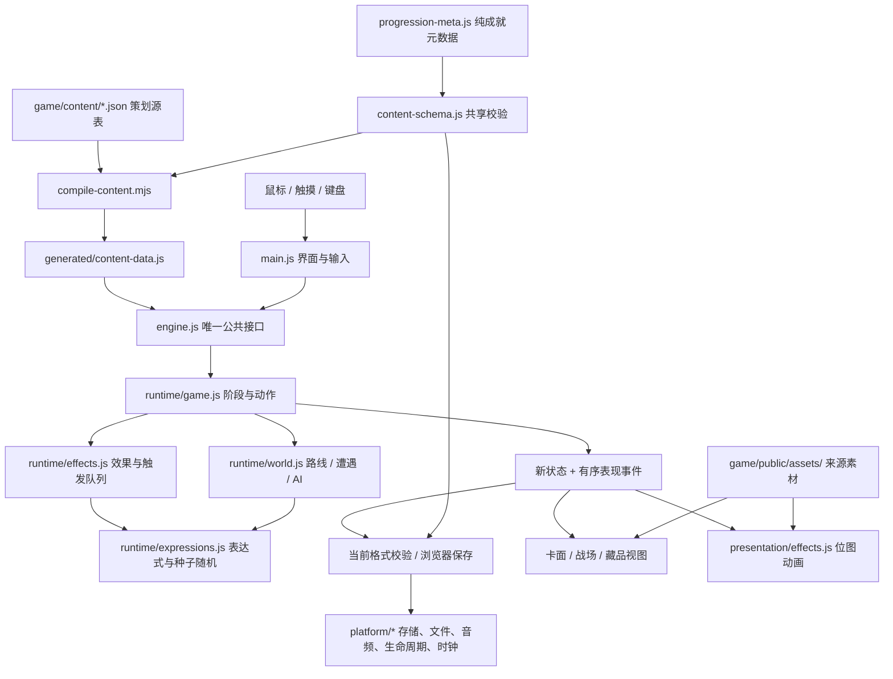

# v0.5 架构与模块边界

更新：2026-10-26。当前产品版本为 v0.5，运行格式为 `version:5 / ruleset:'config-v2'`。全游戏只运行一套配置驱动引擎，不兼容旧存档。过时代码和素材归档到仓库根目录的 `.local/temp/`，不作为运行或构建依赖；正式自动回归随仓库保存在 `tests/`。

本文件说明工程边界；具体字段与可复制示例见 [策划配置指南](CONTENT-AUTHORING-V05.md)，素材规则见 [美术规范](ART-STANDARDS-V05.md)，验证状态见 [开发记录](DEVELOPMENT-V05.md)。

## 仓库目录边界

文中路径均以仓库根目录 `E:\GitHub\Ghost-Ledger` 为基准。`game/` 放游戏本体，`tools/` 放编译、服务、构建及素材工具，`docs/` 放正式文档，`tests/` 放正式自动回归及确定性场景。临时检查、验收证据、各目标构建产物与临时归档分别放 `.local/tests/`、`.local/evidence/`、`.local/dist/<target>/`、`.local/temp/`。整个 `.local/` 由 Git 忽略；已有本地原件保留，正式回归以 `tests/` 为准，干净克隆和 CI 不能依赖本地副本。

游戏源码和静态产物不导入工具或测试文件。`tools/paths.mjs` 集中定位仓库、游戏、正式测试及本地目录，避免根据命令执行位置猜测路径；根 `package.json` 提供统一命令入口。普通开发服务只服务 `game/`，Web 静态预览服务 `.local/dist/web/`。

本地受控夹具通过 `npm run dev:qa` 单独启用：只监听 `127.0.0.2`，默认端口 4212，将 `.local/evidence/` 映射为 `/evidence/`。默认开发与预览服务不提供该入口，归档和本地测试也不进入静态产物。

## 数据流

## 模块职责

| 模块 | 负责 | 不承担 |
| --- | --- | --- |
| `game/content/*.json` | 卡牌、能力、怪物、遭遇、幕、事件、特效、法器、药物 | 可执行函数、DOM、内容专用引擎 |
| `tools/compile-content.mjs` | 校验、引用检查、PNG 检查、内容哈希、生成索引 | 修补错误配置或静默猜测字段 |
| `game/src/runtime/content-schema.js` | 浏览器与 Node 共用的结构、表达式及引用校验 | 加载旧规则或旧格式 |
| `game/src/runtime/expressions.js` | 安全 AST 求值、种子随机、洗牌 | `eval`、任意脚本、预览消耗随机数 |
| `game/src/runtime/effects.js` | 通用效果、触发器、卡区、选择、结算帧与事件 | 按具体 cardId 编写规则分支 |
| `game/src/runtime/world.js` | 路线约束、遭遇配方、怪物实例、声明式 AI 与意图 | 按具体 enemyId 编写 AI 分支 |
| `game/src/runtime/game.js` | 新局、阶段、动作合法性、战斗边界、奖励与通用节点服务、存档验证 | DOM、动画计时 |
| `game/src/engine.js` | 对界面暴露唯一游戏 API | 引擎分流或旧档转换 |
| `game/src/runtime/items.js` | 从生成内容导出的法器、药物目录视图及默认行装标识 | 硬编码道具数值或效果分支 |
| `game/src/progression-meta.js` | 不依赖生成内容的成就元数据，供局外成长和引用校验共用 | 战斗规则、配置加载或存档迁移 |
| `game/src/modes.js`、`game/src/progression.js` | 模式登记、局外解锁、结算与行装 | 战斗效果解释 |
| `game/src/main.js` | 页面、菜单、输入协调、保存、表现调度 | 重新计算卡牌伤害 |
| `game/src/platform/*`、`game/src/save-store.js` | 平台服务契约与实现、当前格式备份恢复及存储错误处理 | 另一套战斗规则或旧引擎 |
| `card-gesture.js`、`combat-targeting.js` | 区分点击与拖拽、目标区域判定 | 支付费用或修改战斗 |
| `card-visuals.js`、`battlefield-view.js`、`collection-view.js` | 四层卡面、敌阵、简洁藏品网格 | 自行定义战斗规则 |
| `game/src/presentation/*` | 消费事件、移动缩放已有位图、受击状态反馈 | 结算伤害、程序绘制美术 |
| `skins.js`、`skin-data.js`、样式表 | 位图切片、比例、排版和响应式布局 | 用代码生成框、按钮、粒子或纹理 |

现有边界是“内容与可组合战斗规则可配置”。法器与药物使用已有通用效果、触发器和允许的修正字段。新增模式入口、全新节点服务或现有 DSL 无法表达的机制仍是工程扩展，不能通过配置字符串执行专用脚本。

## 编译与内容版本

九个源表顶层均为数组，行有唯一 `id`。编译输出 `CONTENT = { cards, powers, enemies, encounters, acts, events, visuals, relics, potions }`，各表按 id 索引；`CONTENT_REVISION` 来源于规范化内容的哈希。新增源文件为 `game/content/relics.json` 和 `game/content/potions.json`，当前分别含 8 件法器与 4 种药物。

校验包括字段、操作参数、表达式、卡牌／能力／道具引用、AI 兜底、遭遇人数、事件退出路径、路线约束及本地 PNG。法器默认行装必须唯一，解锁成就必须存在；药物校验目标、场景、售价及效果组合。非法原型字段、循环对象、过深嵌套与未知操作被拒绝。共享 schema 只导入纯成就元数据，不经 `items.js` 或 `progression.js` 反向导入生成内容。生成文件不接受手改。

开发启动先编译，再监听 `game/content/`。合法修改更新生成文件；非法修改保留上一次有效生成结果并报告错误。页面需要刷新，新配置需新开夜巡；不是自动替换进行中冒险的规则。

Web 构建在 `.local/temp/` 下的空暂存目录进行，旧目标目录归档后再替换。默认输出到 `.local/dist/web/`，根 `index.html` 使用相对路径引用 `releases/<releaseId>/` 内的源码与资源；素材按运行引用优化，源 PNG 和来源原件留在游戏素材目录。`release.json`、`release-manifest.json`、`asset-report.json` 记录内容版本、文件哈希与资源报告，不依赖网站位于域名根目录。工具、测试、备份和来源原件不作为游戏运行兜底。

## 平台与打包边界

`game/targets/manifest.json` 登记 Web、Windows、Android、微信小游戏的目标与共用入口，根命令 `npm run package` 进入检查与准备工具。规则依赖闭包从公共入口收集，不允许混入 DOM、浏览器存储或表现模块。Windows／Android 宿主准备复用 Web 前端；微信小游戏保留共用核心及平台适配位置，仍需独立 Canvas 渲染与输入接入。

平台契约统一存储、文件导入导出、音频、生命周期及时间服务。Web 适配供 DOM 前端与后续 WebView 宿主使用；微信适配明确报告未接入能力。存在目标目录、通过契约检查或生成准备包，不代表已完成原生编译、设备验收、微信发布或线上部署；各阶段状态见 [发布计划](RELEASE-PLAN.md)。

## 动作与结算

公共入口是 `createAdventure`、`transition`、`getCardView`、`getEnemyIntent`、`getAvailableNodes`、`isValidSave` 与 `restoreRun`。它们统一指向配置运行时。

`getCardEnemyTargets(state, card)` 返回存活怪物的 `{ uid, eligible, reason }`，拖拽、点击选敌与实际出牌校验共用目标资格。查询不结算效果或消耗随机数，自身牌返回空列表；香火、缠绕和全局出牌条件不能通过拖拽绕过。护甲、减伤或御符不自动视为不可选中。当前没有新增逐怪免疫机制；后续若增加群攻或随机牌的部分目标限制，效果执行器也必须复用资格判定，不能只隐藏箭头。

界面在拖拽开始时记录敌方命中矩形，悬停和松手使用同一组矩形；反馈只改变明暗，不改变目标尺寸，避免浮动或反馈样式干扰命中。松手后仍由运行时重新检查出牌资格。

1. 界面提出动作，运行时检查阶段、费用、目标和待选状态。
2. 合法动作复制状态，将效果放入结算队列；牌先离开手牌，再按配置执行。
3. 效果按顺序修改状态并派发触发事件。需要选牌时保存 `pendingChoice`，暂停后续队列。
4. 选择动作恢复同一个结算帧。无效输入不重复付费，也不绕过必选步骤。
5. 结算输出新状态和有序 `events`，界面保存并渲染，表现层播放对应事件。

动画只消费结果。重复播放或中断动画均不能再次伤害怪物；等待动画时阻止冲突操作，正在播放的 DOM 副本置于独立表现层，不因主界面重绘而消失。

卡牌区为 `hand / drawPile / discard / exhaust / limbo / powerZone`。持续能力牌进入 `powerZone`，不能因为离开手牌就触发消耗。永久牌副本在 `deckCards` 中保存独立 uid 与 `upgradeLevel`；战内复制、临时费用和成长字段不自动写回永久副本。

## 通用表达与时序

表达式只接受 JSON AST：`stat` 读取上下文，`op` 组合运算，`count` 统计卡区，`debt` 读取阴债摘要，`random` 用种子采样。动态文案由 `textValues` 求值后替换 `{damage}` 等占位符，不按牌名拼特殊文字。

基础效果覆盖伤害、护甲、香火、生命、状态、能力、抽牌、生成、复制、搬牌、消耗、升级、条件、阴债与世界交互。复杂牌由这些操作组合；新机制应扩展共享操作及其校验与回归，再由配置使用。

能力、卡牌、怪物与法器触发共享事件。触发帧中的 `source` 为拥有者，能力的 `power.amount` 为层数，`event` 提供实际伤害、来源、卡牌类型与目标。固定护甲用 `modified:false`；固定效果伤害用 `attack:false`；真实自伤与阴债使用不同 `cause`，不能通过最终生命差猜来源。

法器通过 `combatStart`、`combatVictory`、`debtRepaid` 等事件执行配置效果，`oncePerTurn / oncePerCombat` 限制由共用触发器管理；开场额外抽牌读取 `modifiers.openingDraw`。首回合护甲／属性／香火、实际偿债联动及胜利回血保留原时序，奖励法器从当前局目录抽取。药物先校验使用场景与有效目标，再执行同一效果队列；药物奖励、鬼市抽取和售价来自当前局目录。`runtime/game.js` 不为某个道具 id 另写效果结算分支。

失败事件读取本批最后一条玩家实际损血的 `hpLost`，保留 `cause / sourceUid / cardId`，无法追溯时标记 `unknown`；此前非致死阴债不会覆盖后来的敌人致命攻击。胜利触发效果执行后再次检查死亡，不能让 0 生命状态进入奖励页面。

回合结束有三个期限边界：

| 期限 | 清除位置 | 例子 |
| --- | --- | --- |
| `handEnd` | 回合末在手效果执行后、清理原手牌前 | 禁抽 |
| `turnEnd` | 玩家结束阶段完成、敌方开始前 | 本回合攻击获得护甲等临时能力 |
| `roundEnd` | 敌方行动完成后 | 冥火反击 |

回合末仅清理结束回合时的手牌快照。虚无消耗触发幽冥相拥等抽到的新牌不会被同一批清理再次弃置。每张消耗独立触发，`exhaust.onEach` 可表达逐张收益；不可把它合并成一个总量而改变联动。

## 路线、怪物与随机数

幕定义起始牌组、遭遇池、奖励池、事件池、地图楼层及约束。路线按种子生成节点、类型和连接，保证节点可达并能走到首领；固定层与最早／最晚出现、相邻限制同属数据。

遭遇用固定阵容、变体、槽位或抽袋组合，单场最多 5 怪。怪物定义形象、生命范围、初始状态、行动、AI 规则与事件触发；实例拥有独立 uid、生命、状态、AI 记忆和意图。

AI 依次选取首条符合条件的规则，支持固定行动、循环序列和带权选择，必须存在有效兜底。意图确定时固定本次行动参数，展示与执行读取同一份行动；查看意图、打开详情和重绘不会重抽随机数。

当前模式选择第一幕；新增幕表可由 `createConfiguredAdventure(seed, { actId })` 运行，开放到主页仍需登记模式或章节流程。首领胜利目前结束本次冒险，没有自动衔接第二幕。

## 保存与恢复

当前运行保存 `version:5`、`ruleset:'config-v2'`、`contentRevision`、`contentSnapshot`、`actId`、种子随机状态及局内状态。快照包含全部九表，在新局创建时独立复制；法器、药物效果与局内抽取均读取该局快照。它只解释当前运行时支持的同一 DSL，不用于旧存档迁移，不嵌入另一套引擎，也不保存美术文件字节。

游戏卡牌视图调用 `getCardVisual(card, { latestArtwork: true })`，只按卡牌 ID 将主体图 `visual.icon` 解析到当前配置。手牌、奖励、详情、牌堆和必选牌共用此规则，显示新图不改写运行快照、规则数值、家族、背景或命中特效。当前目录中不存在的快照卡牌保留自己的视觉配置。默认解析仍使用传入对象的视觉字段，供配置编辑草稿等场景使用。

选择中的 `pendingChoice`、`effectQueue` 与 `resolutionFrames` 一同序列化。恢复时校验快照、路线、卡牌实例、怪物、结算帧和阶段；通过后才能继续，不用关闭选择窗口来跳过效果。

局内键为 `ghost-ledger.run.v5`，局外键为 `ghost-ledger.profile.v2`。保存层拒绝旧格式执行，保留已有 `ghost-ledger.run.v4` 原记录；当前记录的上次有效副本与拒绝记录也保留以供恢复或原始导出。备份包导入先校验格式、规则、档案及所需素材，再备份导入前记录；存储失败会报告并尝试回滚。局外结算按 runId 防止重复领取，回府暂停不等同于冒险结算。存储限于当前浏览器来源。

## 扩展验收边界

新增已有操作组合的卡、怪、遭遇或事件应只改源表。新增通用规则时同时更新 schema、解释器、配置示例和独立语义场景，避免只测试实现细节。

正式回归放 `tests/`，由 `npm test` 递归发现 `*.test.mjs`，先编译源表再执行；找不到正式测试视为失败。临时探索留在 `.local/tests/`，验收截图、测试副本与报告仍放 `.local/`，不随 Git 分发。2026-10-26 道具配置专项 15 项通过，覆盖规则、快照、失败归因、工坊隔离保存／备份及真实预览计算；该数字不代替整合后的完整验证。

验证分四层记录：配置与资产校验；确定性规则及恢复场景；浏览器真实交互与响应式表现；真实手机及用户试玩。通过前一层不能代替后一层。最终结果统一写入 [开发记录](DEVELOPMENT-V05.md)，历史版本截图与测试数字不作为本版验收结论。
